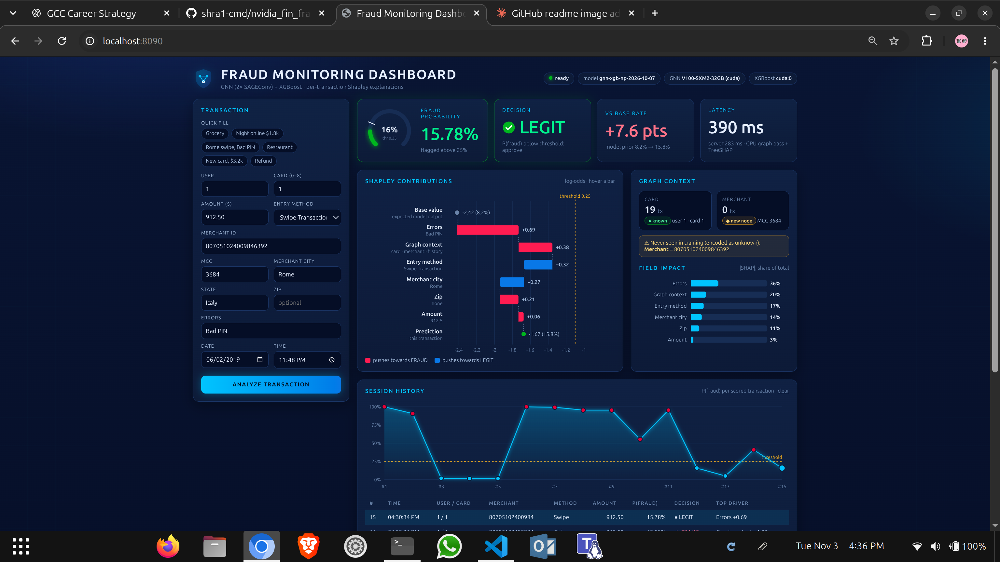

# deploy-fin_fraud: fraud-scoring API (GNN + XGBoost, inference only)

Serves the trained TabFormer node-prediction model behind a plain HTTP API on one V100. There's no
Triton and no training. The model loads once at startup and scores each transaction it receives.



```text
POST /v1/score  {raw transaction JSON}
   │
   ├─ clean     preprocess_data() rules (card id = user*9 + card, " ONLINE", errors, $ amount)
   ├─ encode    encoders_np.pkl lookup tables (fitted at training, never refit)
   ├─ attach    frozen test graph + this tx (known card/merchant → existing node, else new node)
   ├─ GNN       2× SAGEConv, hidden 64, rebuilt on the GPU for every request
   ├─ XGBoost   [38 raw tx features | 64-d tx embedding] = 102 features
   └─ decide    P(fraud) > 0.25 → FRAUD
```

The pipeline is a line-by-line port of `notebooks/single_tx_inference_np.py` and
`predict_new_tx_np.py`. Its outputs match those scripts to within 1e-5 (see `tests/golden/`).

## Decisions

| Topic | Decision |
|---|---|
| GNN embedding | Live GNN forward pass on transaction nodes (what XGBoost was trained on) |
| Context graph | Frozen snapshot of the held-out test graph; scored transactions are not added |
| Per-request work | Graph rebuilt on the GPU for each request (~25.8k tx nodes): ~100 ms per request on the laptop RTX 3050 |
| History features | None needed: preprocessing builds none; the graph supplies card history |
| Model size | hidden_channels = 64 (current model; `archdecision.md` in the repo still describes the older 32) |
| Serving | FastAPI + uvicorn, 1 worker, Docker, one GPU pinned via `device_ids` |
| Threshold | **0.25**: minimises 10 × FN + FP on the test graph (below) |
| Exposure | Bound to 127.0.0.1 on the server; reach it through an SSH tunnel |

### Threshold

Held-out test graph: 25,803 transactions, 2,087 frauds.

| Threshold | Precision | Recall | F1 | False alarms | Missed frauds |
|---|---|---|---|---|---|
| 0.50 (old default) | 0.925 | 0.975 | 0.950 | 164 | 52 |
| **0.25 (chosen)** | 0.853 | **0.993** | 0.918 | 357 | **14** |

At 0.25 the model catches 38 more frauds in exchange for 193 more reviews. The rule assumes a missed
fraud costs about 10× a false alarm. With real costs, rerun
`scripts/choose_threshold.py --fn-cost <ratio> --write`. The value was tuned on the test set, so treat
it as slightly optimistic.

## What goes where

```text
deploy-fin_fraud/
├── CLAUDE.md                 runbook for Claude on the server (auto-loaded there)
├── README.md                 this file
├── Dockerfile                python:3.12-slim + torch 2.7.1 (TORCH_INDEX=cu126 → has V100 sm_70 kernels)
├── docker-compose.yml        GPU pin (GPU_ID), 127.0.0.1:HOST_PORT, artifacts mounted read-only
├── .env.example              GPU_ID, HOST_PORT, TORCH_INDEX, XGB_DEVICE, FRAUD_THRESHOLD
├── requirements.txt          pinned: xgboost 3.0.4 + numpy 1.26.4 (same as training), pyg, fastapi
├── app/
│   ├── pipeline.py           FraudScorer: load → consistency checks → warm-up → score()
│   ├── schemas.py            request / response models
│   └── main.py               FastAPI routes
├── artifacts/                ← copied from the repo by scripts/package_artifacts.sh (70 MB)
│   ├── manifest.json         version, hidden 64, feature dims, threshold 0.25
│   ├── SHA256SUMS
│   ├── encoders_np.pkl       fitted encoders as lookup tables + test-graph card/merchant → node maps
│   ├── model/                model.py, json_loader_writer.py, meta.json,
│   │                         state_dict_gnn_model_np.pth, xgboost_model_np.json
│   └── graph/                frozen context graph: nodes/{transaction,user,merchant,transaction_label}.csv,
│                             edges/{user_to_transaction,transaction_to_merchant}.csv
├── scripts/
│   ├── package_artifacts.sh  [laptop] repo → artifacts/ + checksums
│   ├── choose_threshold.py   [laptop] sweep → manifest threshold
│   ├── write_checksums.sh    [laptop] after any change in artifacts/
│   ├── server_preflight.sh   [server] read-only: driver, GPUs, docker, network, port, disk
│   └── smoke_test.py         [server] acceptance: parity + validation + latency (stdlib only)
└── tests/golden/             reference outputs of the notebook scripts for 8 transactions
```

The server only runs the image and reads `artifacts/`. The laptop-side scripts exist so a future model
can be packaged the same way.

## Handing it to Claude on the server

1. Copy the folder (from the repo root on the laptop):
   ```bash
   rsync -av --exclude '.env' deploy-fin_fraud/ <user>@<server>:~/deploy-fin_fraud/
   ```
2. On the server: `cd ~/deploy-fin_fraud && claude`, then say:
   > Deploy this service by following CLAUDE.md step by step. Stop and ask me before anything that needs sudo, touches the driver, or uses a GPU someone else is on. Finish with the step-7 report.
3. Expect the step-7 report back: GPU, driver, smoke test `ALL CHECKS PASSED`, and latency.
4. From the laptop: `ssh -L 8080:127.0.0.1:8080 <user>@<server>`, then use `http://127.0.0.1:8080/docs`.

## API

`GET /health` · `GET /ready` · `GET /v1/model` · `POST /v1/score` · `POST /v1/score/batch` ·
`POST /v1/explain` · interactive docs at `/docs` · **dashboard UI at `/`**.

`/v1/explain` takes the same body as `/v1/score` and returns the same result plus exact TreeSHAP
contributions of the XGBoost stage, in log-odds, grouped per raw field (Amount, Chip, City, Zip, Errors)
and one `Graph` group for the 64-d GNN embedding (card, merchant, MCC and their history).
`base_value + Σ shap = logit(p_fraud)`. SHAP runs on a CPU copy of the booster (4 threads, ~110 ms);
`p_fraud` comes from the unchanged scoring path.

```bash
curl -s 127.0.0.1:8080/v1/score -H 'Content-Type: application/json' -d '{
  "transaction_id": "demo-1", "user": 1, "card": 1, "amount": "$488.00",
  "use_chip": "Chip Transaction", "merchant_name": "-7807051024009846392",
  "merchant_city": "Rome", "merchant_state": "Italy", "zip": null, "mcc": 3684, "errors": null,
  "year": 2019, "month": 5, "day": 11, "time": "14:05"}'
```
```json
{"model_version": "gnn-xgb-np-2026-10-07", "latency_ms": 100.23,
 "result": {"transaction_id": "demo-1", "p_fraud": 0.965436, "is_fraud": true, "label": "FRAUD",
            "threshold": 0.25, "card_known": true, "merchant_known": true,
            "card_history_tx": 19, "merchant_history_tx": 217, "unseen": {}}}
```

| Field | Required | Notes |
|---|---|---|
| `user`, `card` | yes | card 0–8; model card id = user × 9 + card |
| `amount` | yes | `488.0` or `"$488.00"`; negative = refund; `""` → training median |
| `use_chip` | yes | `Chip Transaction` / `Swipe Transaction` / `Online Transaction` |
| `merchant_name` | yes | anonymised id. **Send it as a string**: it is a 64-bit integer, which JSON clients may round. |
| `mcc` | yes | 0–9999 |
| `merchant_city` | no | default `ONLINE` |
| `zip`, `errors` | no | errors as in the raw data, e.g. `"Bad CVV,Insufficient Balance"` |
| `transaction_id` | no | echoed back |
| `merchant_state`, `year`, `month`, `day`, `time` | no | accepted, not model features |

Unknown fields → 422. In the response, `card_known: false` means the card isn't in the context graph,
so the GNN has no history for it. `unseen` lists values never seen in training; they were encoded as
"unknown".

Batch: `POST /v1/score/batch {"transactions": [...]}` (≤ `MAX_BATCH`, default 1000). All transactions
in a batch share one graph, so same-card transactions see each other.

## Tested on the laptop (RTX 3050, driver 595)

`docker compose up` + `scripts/smoke_test.py --bench 200`: **ALL CHECKS PASSED**. Single scores match
`single_tx_inference_np.py` within 5e-7, batch scores match `predict_new_tx_np.py` within 4e-5, bad input
gets a 422, and latency is p50 102 ms / p95 104 ms. Startup takes 2.5 s.

## Limits to know

- **About 100 ms per request, one at a time.** Almost all of it is rebuilding the full graph on the
  GPU for each request. That's fine for a demo or a few requests per second. For more throughput,
  keep the base graph resident on the GPU, or use `/v1/score/batch`.

- **Context comes from TabFormer.** Real production card or merchant ids won't be in the frozen graph,
  so they score as new nodes with no history (`card_known: false`). In that mode the model is weaker:
  the repo's standalone-batch evaluation shows precision 0.76 vs 0.93 at threshold 0.5.
- **The threshold is tuned on the same test set it's reported on.** Re-tune it with fresh labels.
- **No authentication.** The API is only reachable from the server itself; put auth in front before
  exposing it.
